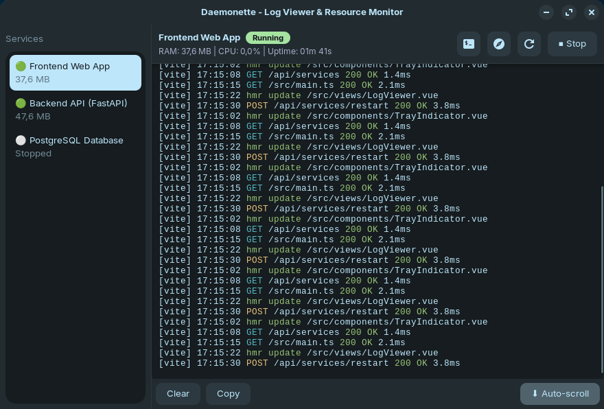
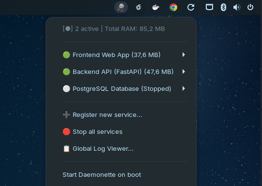
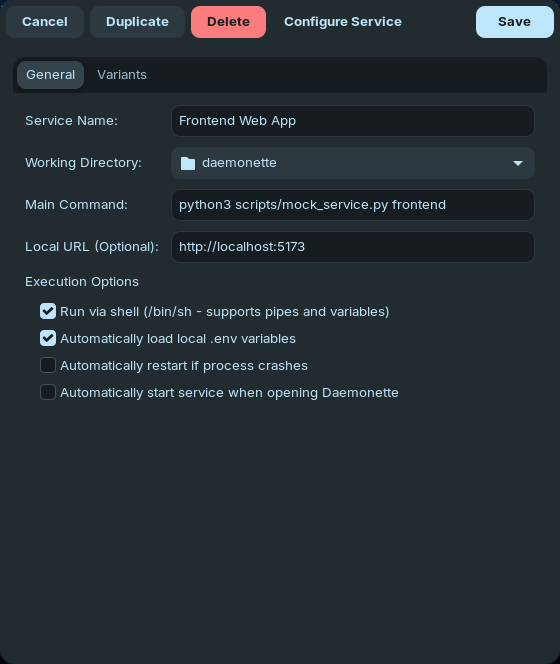

<p align="center">
  
</p>

<h1 align="center">Daemonette</h1>

<p align="center">
  <strong>Gestor ligero para la bandeja del sistema (AppIndicator) para controlar servicios, watchers y procesos locales en Linux sin sobrecoste de memoria.</strong>
</p>

<p align="center">
  <a href="#-características-principales">Características</a> •
  <a href="#-capturas-de-pantalla">Capturas</a> •
  <a href="#-requisitos-del-sistema-y-dependencias">Requisitos</a> •
  <a href="#️-compilación-e-instalación">Instalación</a> •
  <a href="#-uso-rápido">Uso</a> •
  <a href="#-arquitectura-del-proyecto">Arquitectura</a> •
  <a href="README.md">English Version</a>
</p>

<p align="center">
  
  
  
  
  
  
</p>

---

## 📸 Capturas de Pantalla

<p align="center">
  
  <br>
  <em>Visor centralizado de logs con coloreado ANSI, auto-scroll y telemetría de CPU y memoria en tiempo real.</em>
</p>

<p align="center">
  
  &nbsp;&nbsp;&nbsp;&nbsp;
  
  <br>
  <em>Izquierda: Control rápido desde la bandeja del sistema. Derecha: Editor modal de servicios, variables de entorno y variantes.</em>
</p>

---

## 🌟 Características Principales

- **Consumo de Memoria Ultrarreducido:** Escrito en **Vala** con **GTK+ 3.0** y **GLib/GObject**, compilando directamente a código nativo en C. Consume únicamente **~6 MB de memoria privada** (`RssAnon`) y **~20–28 MB de RSS total** (donde la mayor parte son librerías compartidas de GTK y del sistema ya residentes en caché), frente a los 150–350+ MB de alternativas basadas en Electron.
- **Cero Procesos Huérfanos (Aislamiento POSIX PGID):** Cada comando se ejecuta en su propio grupo de procesos (`setpgid`). Al detener un servicio (ej. `npm run dev`, `vite`, `fastapi`), se envía la señal de terminación a todo el árbol de subprocesos (`killpg`), garantizando que ningún puerto quede ocupado.
- **Bandeja del Sistema Minimalista y Jerárquica:** Menú de estado rápido en el panel superior (GNOME, MATE, XFCE, Cinnamon) mediante Ayatana AppIndicator, con submenú dedicado para cada servicio registrado.
- **Variantes de Comandos:** Soporte para ejecutar distintas variantes de un mismo servicio (ej. Modo Desarrollo, Modo E2E, Watcher de compilación, etc.) sin duplicar configuraciones base.
- **Variables de Entorno en Cascada:** Carga automática y herencia de variables desde el sistema, archivos `.env` locales del proyecto y variables personalizadas por servicio o variante.
- **Visor de Logs en Tiempo Real con ANSI:** Ventana centralizada con selector de servicios, coloreado ANSI de terminal, auto-scroll inteligente y monitorización en tiempo real de CPU y memoria RAM consultando `/proc`.
- **Integración con el Entorno:** Accesos directos para abrir la URL del servicio en el navegador predeterminado y abrir terminales modernas (`ptyxis`, `gnome-terminal`, `kitty`, `alacritty`, etc.) en el directorio de trabajo del proyecto.
- **Inicio con el Sistema (Autostart):** Activación/desactivación de inicio de sesión con un solo clic en `~/.config/autostart/`.
- **Soporte Bilingüe Nativo (Inglés y Español):** Detección automática del idioma del sistema operativo (inglés como base, español si el sistema operativo está configurado en español) con selector instantáneo y persistente en el menú de la bandeja o en `services.json`.

---

## 📋 Requisitos del Sistema y Dependencias

Para compilar Daemonette en distribuciones basadas en **Debian / Ubuntu**:

```bash
sudo apt update
sudo apt install -y \
    meson \
    ninja-build \
    valac \
    gcc \
    make \
    libgtk-3-dev \
    libayatana-appindicator3-dev \
    libjson-glib-dev \
    libgee-0.8-dev
```

En **Fedora**:

```bash
sudo dnf install -y \
    meson \
    ninja-build \
    vala \
    gcc \
    make \
    gtk3-devel \
    libayatana-appindicator-gtk3-devel \
    json-glib-devel \
    gee08-devel
```

En **Arch Linux**:

```bash
sudo pacman -S --needed \
    meson \
    ninja \
    vala \
    gcc \
    make \
    gtk3 \
    libayatana-appindicator \
    json-glib \
    libgee
```

---

## 🛠️ Compilación e Instalación

Daemonette incluye un `Makefile` como interfaz simplificada sobre Meson y Ninja para agilizar el flujo de trabajo:

### Opción A: Flujo rápido con `make` (Recomendado)

```bash
# Compilar el proyecto (configura build/ automáticamente si no existe)
make build
# o simplemente:
make

# Compilar y ejecutar la aplicación inmediatamente
make run

# Ejecutar la suite completa de pruebas unitarias
make test

# Generar paquete instalable .deb para Debian/Ubuntu
make deb

# Generar archivo comprimido universal para Linux .tar.gz
make tarball

# Limpiar binarios y objetos compilados
make clean

# Eliminar completamente el directorio build/
make distclean

# Instalar a nivel de sistema (opcional)
sudo make install

# Desinstalar del sistema
sudo make uninstall
```

### Opción B: Flujo manual con Meson y Ninja directo

```bash
# 1. Configurar el directorio de compilación
meson setup build

# 2. Compilar el ejecutable y las pruebas
ninja -C build

# 3. Ejecutar pruebas unitarias
meson test -C build --verbose

# 4. Instalar / Desinstalar a nivel de sistema
sudo ninja -C build install
sudo ninja -C build uninstall
```

---

## 🚀 Uso Rápido

Inicia la aplicación de forma inmediata con:

```bash
make run
```

*(O ejecutando `./build/daemonette` o simplemente `daemonette` si ya lo instalaste en el sistema).*

El icono de Daemonette aparecerá inmediatamente en la bandeja del sistema (AppIndicator):
1. Haz clic en el icono para desplegar el menú principal.
2. Selecciona **➕ Register new service...** para configurar un servicio indicando su nombre, directorio de trabajo y comando.
3. Controla tus servicios directamente con los botones de acción rápida (**Start**, **Stop**, **Restart**, **Open in Browser**, **Open Terminal**).
4. Accede al **📋 Global Log Viewer...** para ver la salida y el consumo de recursos en tiempo real.

---

## 🧪 Pruebas Automatizadas

El proyecto cuenta con una suite completa de pruebas unitarias implementadas sobre el framework `GLib.Test`, verificando:
- Modelos de datos (`ServiceDefinition`, `ServiceVariant`, `ProcessMetrics`, `AppSettings`).
- Buffer circular de logs en memoria (`LogRingBuffer`) y políticas FIFO de descarte.
- Parseo de archivos de variables `.env` (comentarios, comillas, espacios).
- Serialización y persistencia de configuración JSON (`services.json`).
- Ciclo de vida de subprocesos, señales y aislamiento de grupo de procesos (`PGID`).
- Gestor de internacionalización (`I18n`), detección de locale del sistema, diccionarios y señales dinámicas.
- Parseo de secuencias de escape ANSI para formato de texto en terminal.

Ejecutar pruebas:
```bash
make test
# o con meson:
meson test -C build --verbose
```

---

## 🏗️ Arquitectura del Proyecto

```
daemonette/
├── assets/
│   ├── logo.png                      # Logo principal del proyecto (512x512)
│   ├── logo-64.png                   # Variante del logo (64x64)
│   ├── logo-32.png                   # Variante del logo (32x32)
│   └── screenshots/                  # Capturas de pantalla de la interfaz
│       ├── log-viewer.png            # Captura de la ventana principal de logs
│       ├── tray-menu.png             # Captura del menú de la bandeja
│       └── service-dialog.png        # Captura del diálogo de configuración
├── src/
│   ├── main.vala                     # Punto de entrada Gtk.Application y ciclo de vida
│   ├── models/
│   │   ├── service_definition.vala   # Modelos de servicios, variantes y métricas
│   │   └── app_settings.vala         # Configuración global de la aplicación
│   ├── core/
│   │   ├── i18n.vala                 # Gestor de internacionalización (inglés/español)
│   │   ├── service_manager.vala      # Persistencia JSON y parseo de .env
│   │   ├── process_runner.vala       # Subprocesos POSIX (PGID), pipes y señales
│   │   ├── resource_monitor.vala     # Lector de métricas RSS/CPU desde /proc
│   │   ├── log_buffer.vala           # Buffer circular en memoria
│   │   ├── ansi_parser.vala          # Parser ligero de códigos de escape ANSI
│   │   └── terminal_launcher.vala    # Detección y lanzamiento de emuladores de terminal
│   └── ui/
│       ├── tray_indicator.vala       # Menús dinámicos con Ayatana AppIndicator
│       ├── log_viewer_window.vala    # Ventana minimalista de logs y monitorización
│       └── service_editor_dialog.vala# Diálogo de configuración y variantes de servicio
├── tests/
│   ├── test_runner.vala              # Ejecutable principal de pruebas
│   ├── test_utils.vala               # Utilidades de prueba y directorios temporales
│   ├── test_models.vala              # Pruebas unitarias de modelos
│   ├── test_i18n.vala                # Pruebas de i18n y cambio dinámico de idioma
│   ├── test_log_buffer.vala          # Pruebas unitarias de LogRingBuffer
│   ├── test_service_manager.vala     # Pruebas de persistencia JSON y .env
│   ├── test_process_runner.vala      # Pruebas de subprocesos y PGID
│   └── test_ansi_parser.vala         # Pruebas de coloreado y formateo ANSI
├── data/
│   ├── io.github.edpmath.Daemonette.desktop  # Lanzador de escritorio FreeDesktop
│   ├── io.github.edpmath.Daemonette.metainfo.xml # Metadatos de catálogo AppStream
│   └── icons/hicolor/                # Iconos del sistema (16px a 512px)
├── .github/
│   └── workflows/ci.yml              # Flujo CI de GitHub Actions (build y pruebas)
├── packaging/
│   ├── debian/                       # Scripts de control y hooks postinst/postrm de Debian
│   │   ├── control
│   │   ├── postinst
│   │   └── postrm
│   ├── rpm/                          # Archivo de especificación .spec para Fedora/RPM
│   │   └── daemonette.spec
│   └── tarball/                      # Scripts para el archivo portable universal Linux
│       ├── install.sh
│       └── uninstall.sh
├── scripts/
│   ├── build_deb.sh                  # Generador automatizado de paquetes .deb
│   ├── build_tarball.sh              # Generador automatizado de archivo .tar.gz universal
│   └── mock_service.py               # Generador de servicios simulados para pruebas
├── Makefile                          # Wrapper de compilación rápida (build, run, test)
├── meson.build
├── LICENSE
└── README.md
```

---

## 📄 Licencia

Este proyecto está distribuido bajo la licencia [MIT](LICENSE).
