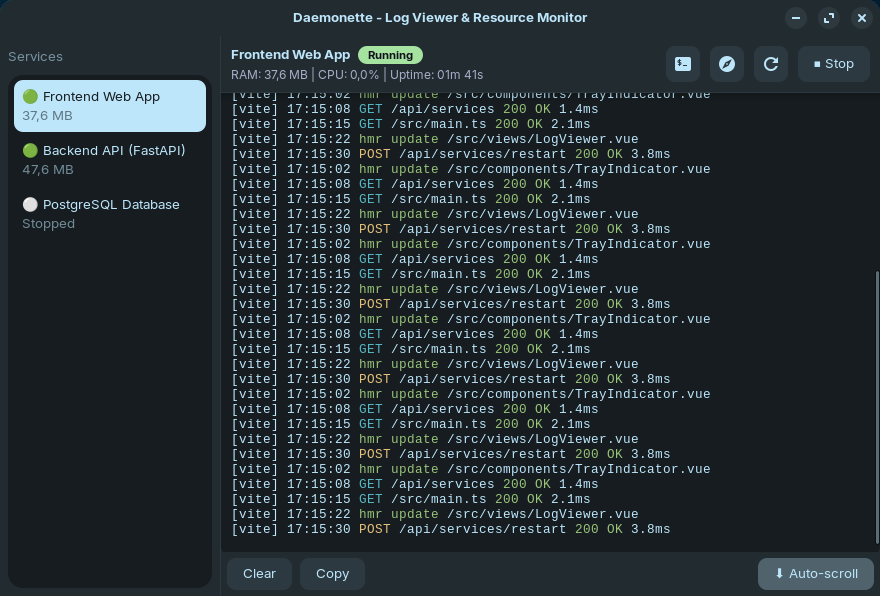
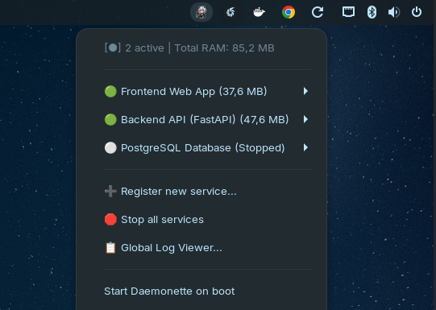
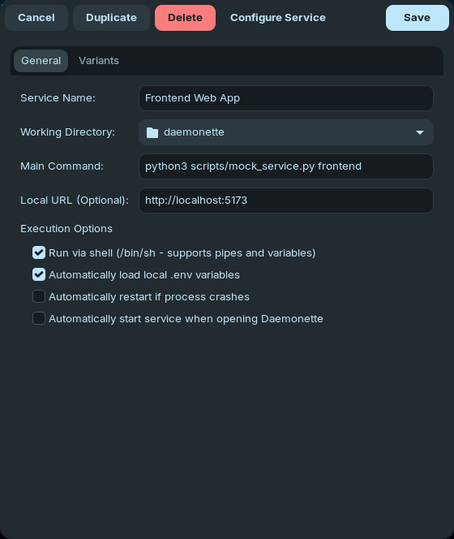

<p align="center">
  
</p>

<h1 align="center">Daemonette</h1>

<p align="center">
  <strong>Lightweight Linux system tray process & service manager for developers, watchers, and local servers with near-zero memory footprint.</strong>
</p>

<p align="center">
  <a href="#-features">Features</a> •
  <a href="#-screenshots">Screenshots</a> •
  <a href="#-requirements--dependencies">Requirements</a> •
  <a href="#️-build--installation">Installation</a> •
  <a href="#-quick-start">Quick Start</a> •
  <a href="#-architecture">Architecture</a> •
  <a href="README.es.md">Versión en Español</a>
</p>

<p align="center">
  
  
  
  
  
  
</p>

---

## 📸 Screenshots

<p align="center">
  
  <br>
  <em>Centralized log viewer featuring real-time ANSI terminal styling, auto-scroll, and live CPU & RAM metrics.</em>
</p>

<p align="center">
  
  &nbsp;&nbsp;&nbsp;&nbsp;
  
  <br>
  <em>Left: Quick management from the desktop system tray. Right: Modal service editor with command variants and environment variables.</em>
</p>

---

## 🌟 Features

- **Ultra-Low Memory Footprint:** Written in **Vala** with **GTK+ 3.0** and **GLib/GObject**, compiling directly to native C binaries. Consumes only **~6 MB of private memory** (`RssAnon`) and **~20–28 MB total RSS** (the bulk of which are shared GTK/system libraries already cached in RAM), compared to 150–350+ MB for Electron-based tools.
- **Zero Orphan Processes (POSIX PGID Isolation):** Every spawned process runs in its own dedicated process group (`setpgid`). Stopping a service (e.g. `npm run dev`, `vite`, `fastapi`, `cargo watch`) issues a termination signal to the entire process group tree (`killpg`), ensuring no ports are left bound.
- **Minimalist & Dynamic System Tray Menu:** Clean status indicators directly in the desktop top/bottom bar (GNOME, MATE, XFCE, Cinnamon) via Ayatana AppIndicator, with dynamic submenus for each registered service.
- **Command Variants:** Configure multiple execution profiles for the same service (e.g., Development mode, E2E testing, Build watcher) sharing the same working directory and base configuration.
- **Cascading Environment Variables:** Automatically loads and resolves `.env` files from project directories, cascading on top of system environment variables and per-service custom key-value pairs.
- **Real-Time ANSI Log Viewer:** Lightweight centralized log window with live ANSI color rendering, service switching, smart auto-scroll, and real-time CPU/RAM telemetry reading directly from Linux `/proc`.
- **Desktop Environment Integration:** One-click shortcuts to launch the service's HTTP URL in the default web browser and spawn modern terminal emulators (`ptyxis`, `gnome-terminal`, `kitty`, `alacritty`, etc.) in the project's root folder.
- **Desktop Autostart:** One-click system autostart toggle managed via FreeDesktop `.desktop` entries in `~/.config/autostart/`.
- **Native Bilingual Support (English & Spanish):** Automatic operating system locale detection (defaults to English, automatically switches to Spanish when the system locale is Spanish) and instant, persistent language selection directly from the system tray menu or `services.json`.

---

## 📋 Requirements & Dependencies

To build Daemonette on **Debian / Ubuntu** based distributions:

```bash
sudo apt update
sudo apt install -y \
    meson \
    ninja-build \
    valac \
    gcc \
    make \
    libgtk-3-dev \
    libayatana-appindicator3-dev \
    libjson-glib-dev \
    libgee-0.8-dev
```

On **Fedora**:

```bash
sudo dnf install -y \
    meson \
    ninja-build \
    vala \
    gcc \
    make \
    gtk3-devel \
    libayatana-appindicator-gtk3-devel \
    json-glib-devel \
    gee08-devel
```

On **Arch Linux**:

```bash
sudo pacman -S --needed \
    meson \
    ninja \
    vala \
    gcc \
    make \
    gtk3 \
    libayatana-appindicator \
    json-glib \
    libgee
```

---

## 🛠️ Build & Installation

Daemonette includes a convenient `Makefile` wrapping Meson and Ninja to simplify everyday development:

### Option A: Fast Workflow with `make` (Recommended)

```bash
# Build the project (automatically sets up build/ if needed)
make build
# or simply:
make

# Build and launch Daemonette immediately
make run

# Run the complete automated test suite
make test

# Build standalone Debian/Ubuntu .deb package
make deb

# Build standalone universal Linux .tar.gz archive
make tarball

# Clean compiled objects and binaries
make clean

# Remove the build directory completely
make distclean

# Install system-wide (optional)
sudo make install

# Uninstall from system
sudo make uninstall
```

### Option B: Direct Meson & Ninja Workflow

```bash
# 1. Setup the build directory
meson setup build

# 2. Compile binary and test suite
ninja -C build

# 3. Run unit tests
meson test -C build --verbose

# 4. Install / Uninstall system-wide
sudo ninja -C build install
sudo ninja -C build uninstall
```

---

## 🚀 Quick Start

Launch the application directly with:

```bash
make run
```

*(Or by running `./build/daemonette`, or simply typing `daemonette` in your terminal if installed system-wide).*

The Daemonette flame icon will appear in your desktop system tray (AppIndicator):
1. Click the tray icon to view the service menu.
2. Select **➕ Register new service...** to configure a service name, working directory, and command.
3. Manage service lifecycles with quick actions (**Start**, **Stop**, **Restart**, **Open in Browser**, **Open Terminal**).
4. Open the **📋 Global Log Viewer...** to inspect real-time outputs, search logs, and monitor live system resource usage.

---

## 🧪 Automated Testing

Daemonette features a comprehensive unit test suite built on top of `GLib.Test`, validating:
- Data models (`ServiceDefinition`, `ServiceVariant`, `ProcessMetrics`, `AppSettings`).
- In-memory circular log ring buffer (`LogRingBuffer`) and FIFO eviction rules.
- `.env` variable file parser (handling quotes, whitespace, comments, escapes).
- JSON configuration persistence and schema serialization (`services.json`).
- Subprocess lifecycle management, POSIX signal handling, and process group isolation (`PGID`).
- Internationalization manager (`I18n`), system locale detection, dictionary lookups, and dynamic switching signals.
- ANSI escape sequence parser for terminal text formatting and 16/256-color palettes.

Run all tests:
```bash
make test
# or with meson:
meson test -C build --verbose
```

---

## 🏗️ Architecture

```
daemonette/
├── assets/
│   ├── logo.png                      # Primary project logo (512x512)
│   ├── logo-64.png                   # Scaled logo (64x64)
│   ├── logo-32.png                   # Scaled logo (32x32)
│   └── screenshots/                  # High-resolution UI screenshots
│       ├── log-viewer.png            # Real-time log viewer & resource monitor
│       ├── tray-menu.png             # System tray AppIndicator menu
│       └── service-dialog.png        # Service & variant configuration modal
├── src/
│   ├── main.vala                     # Application entry point and Gtk.Application lifecycle
│   ├── models/
│   │   ├── service_definition.vala   # Service, variant, and process metric models
│   │   └── app_settings.vala         # Application-level configuration settings
│   ├── core/
│   │   ├── i18n.vala                 # Internationalization manager (English/Spanish)
│   │   ├── service_manager.vala      # JSON persistence and .env resolution
│   │   ├── process_runner.vala       # POSIX process group runner (PGID), pipes & signals
│   │   ├── resource_monitor.vala     # Linux /proc CPU & RSS memory telemetry sampler
│   │   ├── log_buffer.vala           # Fixed-capacity circular log buffer
│   │   ├── ansi_parser.vala          # ANSI escape code parser with GTK TextTag mapping
│   │   └── terminal_launcher.vala    # Terminal emulator discovery and execution
│   └── ui/
│       ├── tray_indicator.vala       # Ayatana AppIndicator dynamic menu manager
│       ├── log_viewer_window.vala    # Dark-themed log viewer & telemetry dashboard
│       └── service_editor_dialog.vala# Service and command variant editor dialog
├── tests/
│   ├── test_runner.vala              # Test suite entry point
│   ├── test_utils.vala               # Test helpers and temporary sandbox directories
│   ├── test_models.vala              # Unit tests for domain models
│   ├── test_i18n.vala                # Unit tests for i18n & dynamic language switching
│   ├── test_log_buffer.vala          # Unit tests for LogRingBuffer
│   ├── test_service_manager.vala     # Unit tests for JSON config & .env parsing
│   ├── test_process_runner.vala      # Unit tests for process groups and signaling
│   └── test_ansi_parser.vala         # Unit tests for ANSI parsing & color mapping
├── data/
│   ├── io.github.edpmath.Daemonette.desktop  # FreeDesktop desktop launcher
│   ├── io.github.edpmath.Daemonette.metainfo.xml # AppStream catalog metadata
│   └── icons/hicolor/                # Standard FreeDesktop icon hierarchy (16px to 512px)
├── .github/
│   └── workflows/ci.yml              # GitHub Actions CI workflow (build & tests)
├── packaging/
│   ├── debian/                       # Debian/Ubuntu control, postinst & postrm scripts
│   │   ├── control
│   │   ├── postinst
│   │   └── postrm
│   ├── rpm/                          # Fedora/RPM package spec
│   │   └── daemonette.spec
│   └── tarball/                      # Universal Linux portable archive scripts
│       ├── install.sh
│       └── uninstall.sh
├── scripts/
│   ├── build_deb.sh                  # Automated Debian package builder
│   ├── build_tarball.sh              # Automated universal tarball builder
│   └── mock_service.py               # Simulated multi-service workload generator
├── Makefile                          # Development task runner (build, run, test, clean)
├── meson.build                       # Meson build definitions and dependencies
├── LICENSE                           # MIT License
├── README.md                         # English documentation (primary)
└── README.es.md                      # Spanish documentation
```

---

## 📄 License

This project is licensed under the [MIT License](LICENSE).
